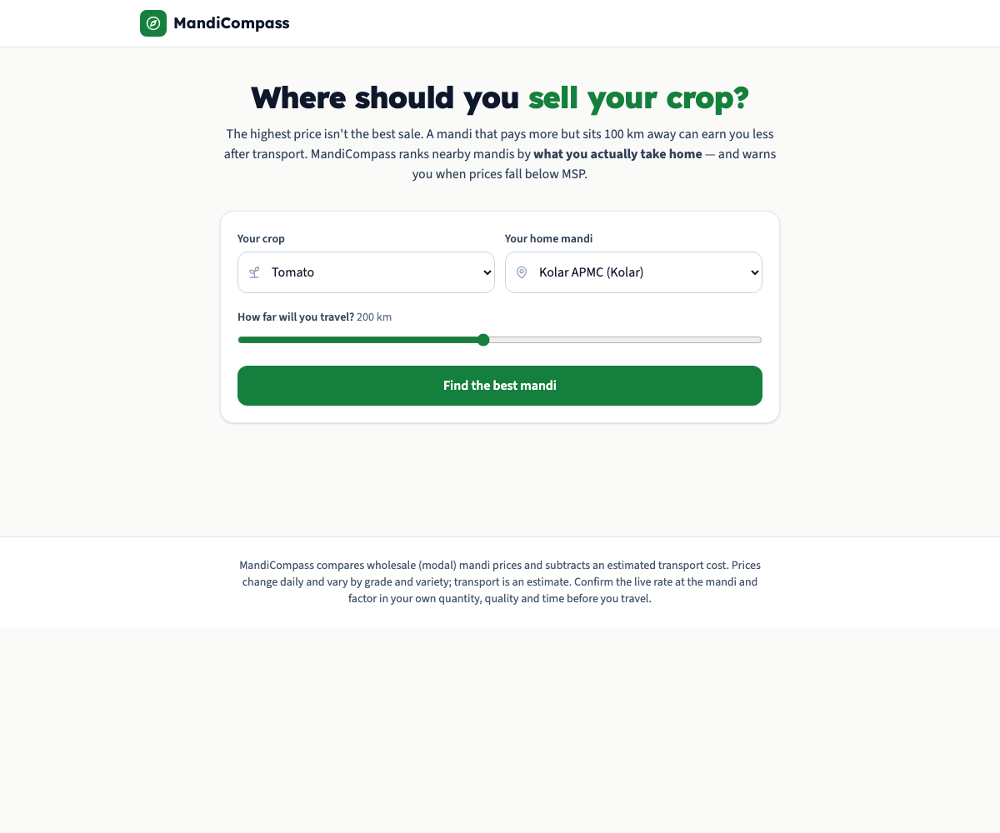
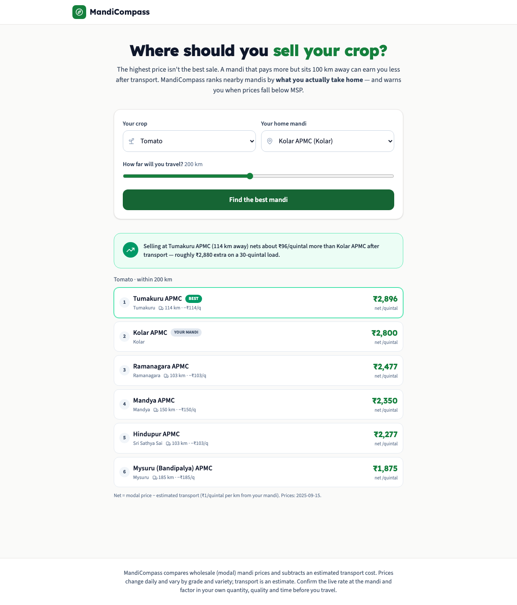
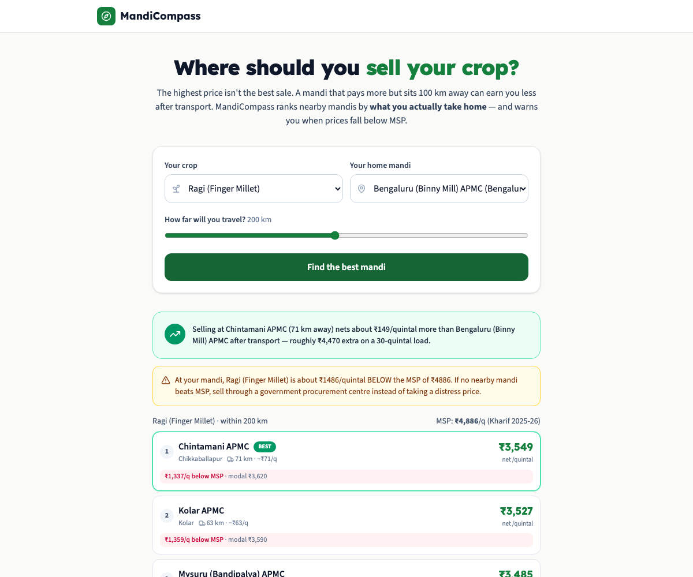

# MandiCompass

**Where should a farmer actually sell? The mandi with the highest price often isn't the one that pays the most — after transport, and after MSP.**

A farmer with a load of tomatoes can sell at the local mandi or haul it 100 km to one quoting ₹300/quintal more. Every "today's mandi price" app shows the sticker prices and stops there. But the higher price can *lose* money once you subtract the cost of getting there — and none of them tell you when the price you're being offered is **below the government's Minimum Support Price**, which is the signal that actually protects a small farmer from a distress sale.

MandiCompass answers the real question: **which nearby mandi nets the most per quintal, after transport — and is anyone even paying MSP?**

| | | |
|---|---|---|
|  |  |  |

## How it works

### The data

- **MSP** — all 2025-26 Minimum Support Prices from the Cabinet/CACP (paddy ₹2,369, wheat ₹2,425, ragi ₹4,886, tur ₹8,000, cotton ₹7,710 …) for 15 notified crops, plus three vegetables (tomato, onion, potato) that have no MSP. **Real, verifiable figures.**
- **Markets** — 20 real APMC mandis across Karnataka and the border belt, with coordinates for distance maths.
- **Prices** — a live ingestion client, [`scripts/fetch.py`](backend/scripts/fetch.py), pulls daily market prices from the **Agmarknet feed on data.gov.in** and maps each record's free-text commodity/market name onto the dataset's ids. The committed `data/prices.json` is an **illustrative snapshot in the exact Agmarknet schema** — modal prices anchored to real September-2025 reference levels — because the public API has frequent outages; run the fetcher to refresh with live data. The snapshot's synthetic, reproducible origin is documented in its `_meta` block and in the generator, [`scripts/make_sample_prices.py`](backend/scripts/make_sample_prices.py).

### The engine — net price, not sticker price

[`backend/app/engine.py`](backend/app/engine.py) is the part that matters:

```
net price at a mandi = modal price − (distance from your mandi × transport rate)
```

Distance is computed with the haversine formula from your home mandi's coordinates; the transport rate defaults to **₹1/quintal per km** (a mini-truck runs ~₹30–40/km carrying 30–40 quintals — documented and adjustable). Mandis are then **ranked by net price**, so a far mandi only wins if its price beats the local one *after* the trip.

**MSP awareness** runs alongside: every quote is compared to the crop's MSP, mandis below it are flagged, and if your local mandi (or every mandi in range) is below MSP, the report tells you to use a government procurement centre instead of taking the distress price.

**Example.** Tomato, home mandi Kolar, willing to travel 200 km:

```
✅ Selling at Tumakuru APMC (114 km away) nets ~₹96/quintal more than Kolar
   after transport — roughly ₹2,880 extra on a 30-quintal load.

1. Tumakuru APMC   net ₹2,896   (modal ₹3,010 − ₹114 transport, 114 km)   BEST
2. Kolar APMC      net ₹2,800   (your mandi)
3. Ramanagara APMC net ₹2,477   (modal ₹2,580 − ₹103 transport, 103 km)
...
```

And for **ragi** (MSP ₹4,886), where the open market sits far below:

```
⚠ At your mandi, Ragi is about ₹1,486/quintal BELOW the MSP of ₹4,886.
  If no nearby mandi beats MSP, sell through a government procurement centre.
```

### API

```
GET /api/commodities                         crops with MSP
GET /api/markets                             APMC mandis
GET /api/arbitrage?commodity=&origin=&max_distance=&transport_rate=
                                             ranked net-price quotes + MSP analysis
GET /api/stats · /api/meta · /api/health
```

Consistent `{"error": {code, message}}` envelope; input validated (distance bounds, known commodity/market).

## Running it

```bash
docker compose up --build
# frontend → http://localhost:3300   API → http://localhost:8300/docs
```

Local dev:

```bash
cd backend
python3 -m venv .venv && .venv/bin/pip install -r requirements-dev.txt
# refresh prices from the live Agmarknet API (when it's up):
DATABASE_URL=sqlite:///dev.db .venv/bin/python -m scripts.fetch --state Karnataka
DATABASE_URL=sqlite:///dev.db .venv/bin/python -m scripts.seed
DATABASE_URL=sqlite:///dev.db .venv/bin/uvicorn app.main:app --reload --port 8300
cd frontend && npm install && npm run dev
```

### Tests

```bash
cd backend && .venv/bin/python -m pytest    # 19 tests
```

Tests pin the haversine distance, the **net-price-beats-sticker-price** ranking (a far, higher-priced mandi correctly losing to the local one after transport), the distance filter, the below-MSP distress alert, the Agmarknet name-matching, and that the MSP figures loaded are the real 2025-26 values.

## Data sourcing & verification

- MSP values are the official 2025-26 figures and are the dataset's verifiable backbone.
- The price snapshot is **explicitly labelled** as illustrative wherever it appears (data `_meta`, the generator, this README, the UI disclaimer). The live fetcher is the real path; the snapshot exists so the demo runs offline.
- The UI repeats that prices change daily, vary by grade/variety, and that transport is an estimate — confirm at the mandi before travelling.

## Limitations

- **Prices are a snapshot.** The bundled data is illustrative; production would run `scripts.fetch` on a schedule (and the data.gov.in API needs to be up).
- **Transport is a flat per-km estimate** — real cost depends on truck size, road, and load; the rate is adjustable per request.
- **Coverage is one region** (Karnataka + border mandis). The model is national; it's a matter of loading more markets with coordinates.
- Straight-line distance slightly understates road distance.

## What I'd build next

1. **Scheduled live ingestion** with history, so the tool shows price *trends* and the best day to sell, not just today.
2. **GPS / village origin** instead of picking a mandi — geocode the farmer's location and find mandis around *them*.
3. **Real road distance & cost** via a routing API, and shared-transport pooling between nearby farmers.
4. **Procurement-centre integration** — when everything's below MSP, route to the nearest active government procurement centre with its open dates.
